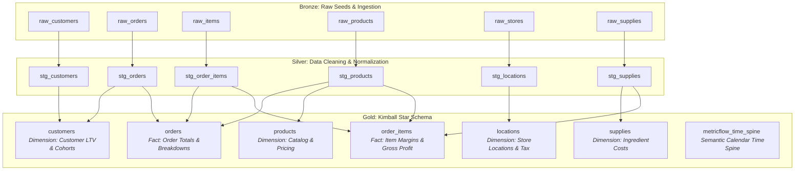

# 🥪 The Jaffle Shop — Enterprise Analytics Engineering Pipeline

[](https://www.getdbt.com/)
[](https://en.wikipedia.org/wiki/Dimensional_modeling)
[](./data-tests)
[](./.sqlfluff)
[](https://github.com/NimaiGaba)

> **Author:** Nimai Gaba ([@NimaiGaba](https://github.com/NimaiGaba))

---

## 📌 Executive Summary & Architecture

The **Jaffle Shop** analytics repository is an end-to-end, production-grade analytics engineering pipeline built with **dbt (data build tool)**. It transforms raw transactional records from a multi-unit quick-service restaurant franchise into curated, star-schema dimensional models and semantic metrics.

This pipeline models customer purchasing behavior, order-level economics, menu item profitability, ingredient supply costs, and geographic store performance to empower executive leadership with real-time, audit-ready financial insights.



---

## 🏗️ Layer-by-Layer Data Modeling Breakdown

The architecture strictly follows the **Medallion / Kimball Dimensional Modeling** paradigm:

### 1. Staging Models (`models/staging/`)
* **`stg_customers`**: Cleans raw customer identities, extracts first and last names, and validates customer uniqueness.
* **`stg_orders`**: Standardizes order timestamps, categorizes payment statuses, and cleans currency decimals.
* **`stg_order_items`**: Unpacks basket-level transaction line items with foreign key references to orders and products.
* **`stg_products`**: Normalizes product names, food vs. beverage categorizations, and standardizes prices.
* **`stg_locations`**: Store master data containing geographical locations, open dates, and regional tax brackets.
* **`stg_supplies`**: Ingestion of raw ingredients and wholesale supply contracts with perishable classifications.

### 2. Marts Dimension & Fact Tables (`models/marts/`)
* **`customers` (Core Customer Dimension)**:
  Aggregates lifetime spend, order frequency, first order timestamp, most recent order timestamp, and classifies customer activity status into actionable cohorts.
* **`orders` (Core Orders Fact)**:
  Order grain enriched with food versus beverage subtotal breakdowns, tax amounts, order item counts, and customer associations.
* **`order_items` (Line-Item Financial Fact)**:
  Calculates margin per unit sold by joining product sale prices against upstream ingredient supply costs from `stg_supplies`.
* **`locations`**:
  Aggregates store performance, opening tenure, and gross contribution per territory.
* **`metricflow_time_spine`**:
  Cross-database portable calendar spine enabling cumulative, period-over-period, and windowed semantic metrics.

---

## 📊 Analytical Deep-Dives & Reports (`analyses/`)

Beyond standard pipeline execution, this repository features ad-hoc SQL analytical assets:

1. **[`customer_cohort_retention.sql`](analyses/customer_cohort_retention.sql)**:
   Groups customer acquisitions into monthly cohorts to track long-term retention curves, average lifetime orders, and LTV progression over a multi-year horizon.
2. **[`store_performance_pareto.sql`](analyses/store_performance_pareto.sql)**:
   Conducts an 80/20 Pareto revenue distribution analysis across store locations, calculating gross sales velocity and net revenue share.

---

## 🛡️ Data Quality & Automated Testing

Data reliability is maintained through rigorous automated tests:

* **Generic Constraints**: `unique`, `not_null`, `accepted_values`, and `relationships` tested across primary keys and foreign keys in YAML schemas.
* **Singular Business Rules**:
  * [`assert_positive_total_money_spent.sql`](data-tests/assert_positive_total_money_spent.sql): Enforces that all completed orders and line-item transactions maintain strictly non-negative monetary amounts.
* **Linter & Code Standards**:
  * [`.sqlfluff`](.sqlfluff) configuration guaranteeing uniform indentation, capitalized keywords, explicit aliasing, and consistent SQL formatting.

---

## 🚀 Quickstart Guide

### 1. Prerequisites
* Python 3.10+
* Virtual environment (`venv` or `uv`)

### 2. Installation
```bash
# Clone the repository
git clone https://github.com/NimaiGaba/jaffle-shop.git
cd jaffle-shop

# Create and activate virtual environment
python -m venv .venv
source .venv/bin/activate  # On Windows: .venv\Scripts\Activate.ps1

# Install requirements and dbt
pip install -r requirements.txt
pip install dbt-core dbt-duckdb
```

### 3. Running the Pipeline
```bash
# 1. Install dbt package dependencies
dbt deps

# 2. Seed initial transactional dataset
dbt seed --vars '{"load_source_data": true}'

# 3. Build all models, run transformations, and execute tests
dbt build

# 4. Generate and view interactive lineage docs
dbt docs generate
dbt docs serve
```

---

## 📁 Repository Directory Structure

```text
jaffle-shop/
├── .github/
│   ├── workflows/
│   │   └── ci.yml               # Automated CI linting and validation
│   └── CODEOWNERS               # Repository ownership
├── analyses/
│   ├── customer_cohort_retention.sql
│   └── store_performance_pareto.sql
├── data-tests/
│   └── assert_positive_total_money_spent.sql
├── macros/
│   ├── cents_to_dollars.sql     # Currency transformation macro
│   └── generate_schema_name.sql # Multi-environment schema resolution
├── models/
│   ├── staging/                 # Normalized views & source definitions
│   └── marts/                   # Kimball star-schema dimensions & facts
├── seeds/
│   └── jaffle-data/             # Raw transactional seed datasets
├── .pre-commit-config.yaml      # Git hook automation
├── .sqlfluff                    # SQL style enforcement config
├── dbt_project.yml              # Project root configuration
├── packages.yml                 # dbt package dependencies
└── requirements.txt             # Python dependencies
```

---

## 👨‍💻 Author & Maintainer

* **Nimai Gaba** — *Author*
* **GitHub:** [@NimaiGaba](https://github.com/NimaiGaba)
* **Email:** [che240008021@iiti.ac.in](mailto:che240008021@iiti.ac.in)
